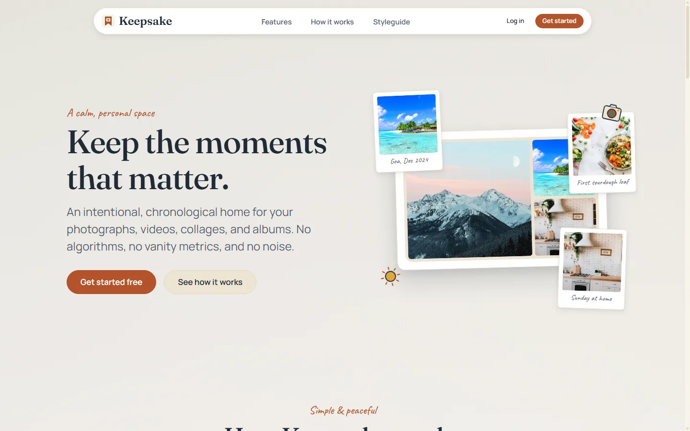
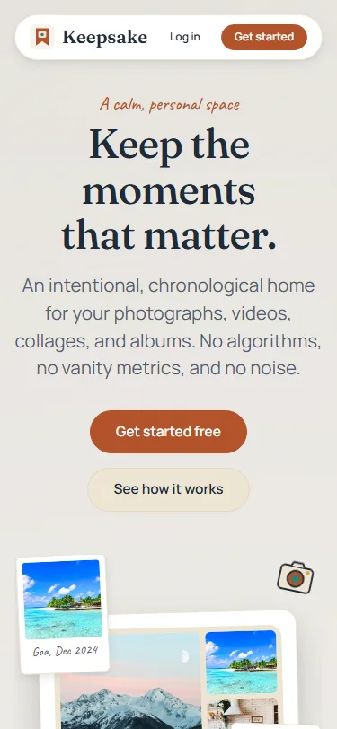
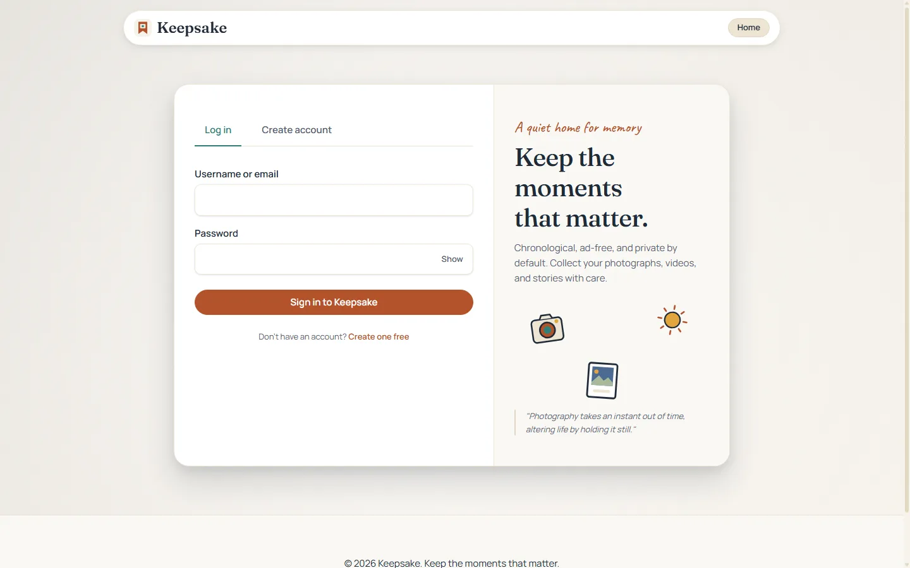
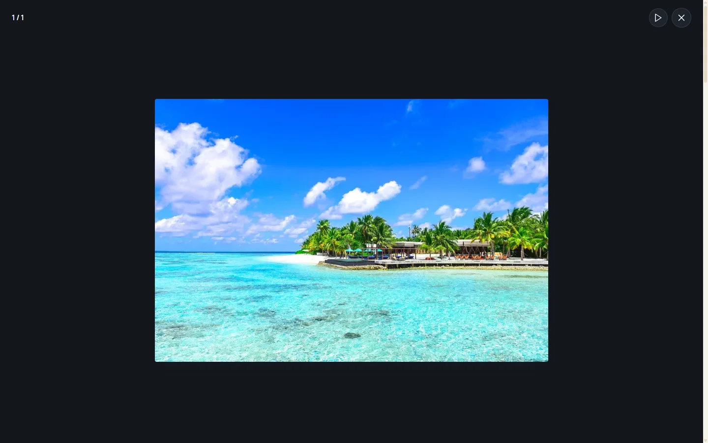
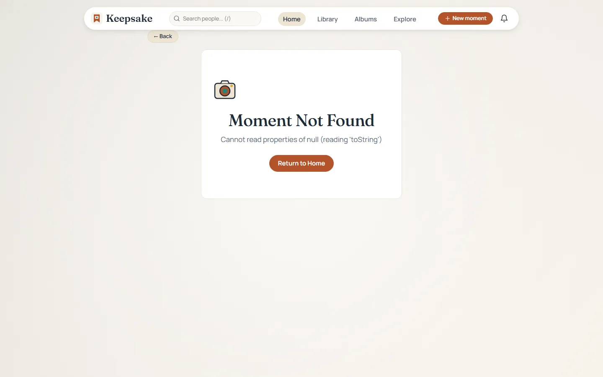
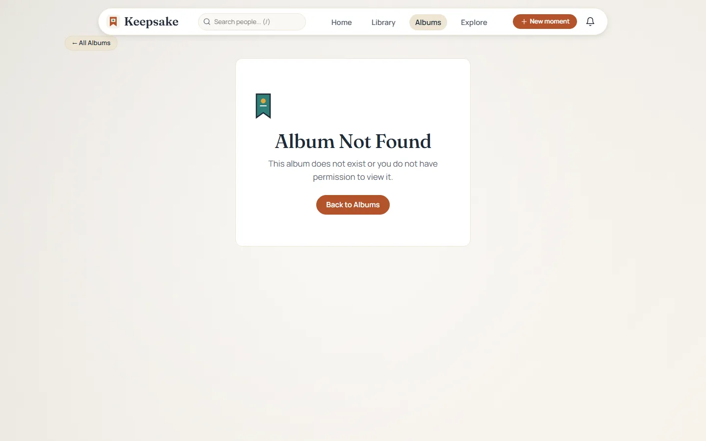
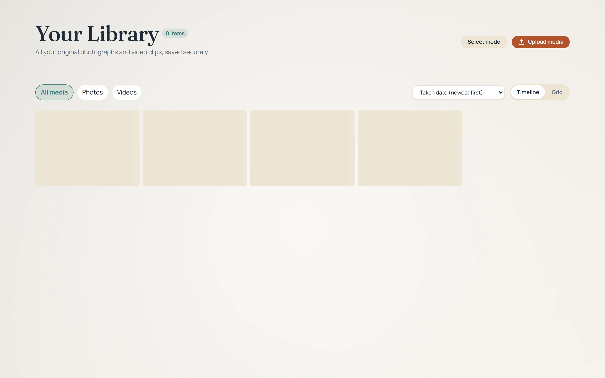
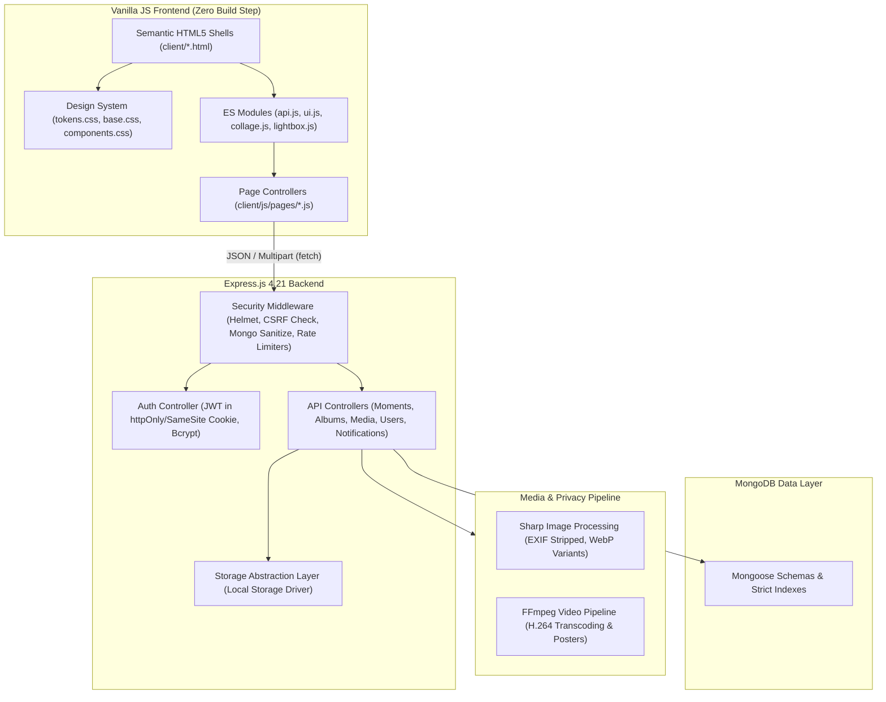
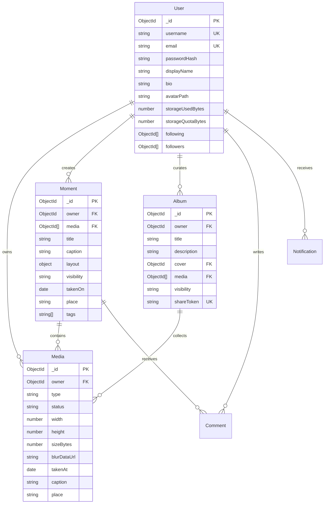

# Keepsake

> **A calm, photo-first, chronological memory-keeping social web app.**  
> Keep the moments that matter — free from algorithmic ranking, vanity metrics, and noisy ads.

---

## 📸 Overview & Screenshots

Keepsake is a social space designed for slow, authentic memory preservation. Photos, short videos, and journals are shared in chronological order, with flexible collage layouts, quiet interactions, and fine-grained privacy controls.

### Desktop Experience (1440px)


### Multi-Device Responsive Experience

| Mobile Landing (375px) | Feed Experience (1440px) | Fullscreen Charcoal Lightbox |
| :---: | :---: | :---: |
|  |  |  |
| *Polaroid tilt & touch layout* | *Chronological moments & on-this-day* | *Full-resolution view with credits* |

| Editorial Collage Moments | Curated Album Gallery | Library Timeline |
| :---: | :---: | :---: |
|  |  |  |
| *Handcrafted CSS grid templates* | *Justified aspect-ratio rows* | *Chronological media archive* |

---

## ⚡ Quickstart

### 1. Zero-Setup Demo Mode (Recommended)
Run a single command to spin up an in-memory MongoDB database, seed 8 demo personas with real stock photos and albums, and launch the application:

```bash
npm run demo
```

Open **`http://localhost:5000`** in your browser.  
Log in with test account `@clara` (password: `Password123`) or browse public moments as a guest.

### 2. Standard Development Mode
```bash
git clone <repository-url> keepsake
cd keepsake
npm install
cp .env.example .env
npm start
```

---

## 🚀 Deploy to Render

[](https://render.com/deploy?repo=https://github.com/princek58/codealpha_task_Keepsake)

1. **Free Demo Mode (`render.yaml` - Default):**  
   Deploys on Render's free web tier using ephemeral `/tmp` storage. On initial boot or container restart, Keepsake automatically restores its 8 demo personas and media library from the bundled `demo-bundle/` package in under 3 seconds. Ideal for portfolio reviews, live client previews, and evaluations.

2. **Persistent Production Mode (`render.persistent.yaml`):**  
   Attaches a persistent SSD disk (`keepsake-data` mounted at `/var/data`) so user uploads, collages, and full albums persist permanently across deployments and restarts.

For full step-by-step setup (including free MongoDB Atlas configuration and custom domain setup), see the complete [Deployment Guide](docs/DEPLOY.md).

### Environment Variables

| Variable | Required | Default | Purpose |
| :--- | :--- | :--- | :--- |
| `MONGODB_URI` | **Yes** | — | MongoDB Atlas or self-hosted connection string |
| `JWT_SECRET` | **Yes** | — | Secure random secret for signing authentication cookies |
| `NODE_ENV` | No | `development` | Runtime environment (`production` enables secure cookies & strict security) |
| `PORT` | No | `5000` | Port for the Express HTTP server |
| `PUBLIC_URL` | No | `http://localhost:5000` | Canonical public URL used for CORS and CSRF validation |
| `CLIENT_ORIGIN` | No | `http://localhost:5000` | Origin URL permitted for state-changing browser requests |
| `ALLOWED_ORIGINS`| No | — | Comma-separated list of additional permitted origins |
| `STORAGE_DIR` | No | `./server/storage` | Path for uploaded media files (e.g. `/var/data/storage` or `/tmp/storage`) |
| `DEMO_MODE` | No | `false` | Enables demo banner, guest-friendly notices, and login autofill |
| `SEED_DEMO_ON_BOOT` | No | `false` | Automatically restores demo personas and media from `demo-bundle/` on empty database |
| `RECONCILE_STORAGE_ON_BOOT` | No | `false` | Audits disk against DB records on startup and fixes missing files safely |
| `TRUST_PROXY` | No | `false` | Set to `true` or hop count behind reverse proxies (Render, Cloudflare) |

---

## 🖼 Demo Media & Pexels Integration

Keepsake comes bundled with **70 high-resolution stock photographs** and **6 short video clips** organized across 7 core life themes in `demo-media/`:
- **Travel:** Rugged Himalayan passes, coastal shorelines, old quarter cobblestone alleys, and morning riverboats.
- **Home:** Sunlit linen curtains, morning pour-over coffee, cozy reading nooks, and fresh sourdough bread.
- **Friends:** Evening campfire gatherings, seaside bicycle rides, and road trip milestones.
- **Pets:** Sleepy golden retrievers, sunbeam cats, and meadow play sessions.
- **Food:** Warm bakery loaves, sizzling street snacks, and rustic kitchen spreads.
- **Nature:** Morning mist over pine forests, rushing waterfalls, and starscapes.
- **Hobbies:** Wheel-thrown ceramics, 35mm mechanical cameras, vinyl turntables, and botanical pressing.

All assets are normalized (JPEG max 1600px, WebP variants, metadata stripped) and total under 18 MB.

### Seeding Demo Data
To seed your database with all 8 demo personas, 28 moments, 10 albums, and social engagement:
```bash
npm run seed
```

### Optional: Fetching Fresh Media (`PEXELS_API_KEY`)
The application is 100% self-contained and does **not** require any API keys to run, demo, or develop. If a developer wishes to fetch a completely fresh set of photos and short videos directly from the Pexels REST API:
1. Obtain a free API key at [pexels.com/api](https://www.pexels.com/api/).
2. Add your key to `.env`:
   ```bash
   PEXELS_API_KEY=your_key_here
   ```
3. Run the ingest script:
   ```bash
   npm run fetch-demo-media
   npm run build:landing-assets
   ```

---

## 🏗 Architecture Overview

Keepsake is built without client frameworks. The frontend uses modern native ES modules with zero build steps, while the backend leverages Node.js, Express, Sharp, and MongoDB.



---

## 🗄 Entity-Relationship Diagram



---

## 📋 API & Scripts Overview

Comprehensive documentation of all backend endpoints is maintained in [`API.md`](docs/API.md).

### Development & Operational Scripts

| Command | Purpose |
| :--- | :--- |
| `npm run demo` | Single-command zero-setup demo with in-memory MongoDB & seed data |
| `npm start` | Launches production server on port 5000 |
| `npm run dev` | Launches development server with nodemon |
| `npm run seed` | Seeds database with 8 personas, 28 moments, and 10 albums |
| `npm run build-demo-bundle` | Packages database seed and normalized media into `demo-bundle/` for instant ephemeral deploy recovery |
| `npm run fetch-demo-media` | Ingests and normalizes stock media from Pexels API / direct CDN |
| `npm run build:landing-assets` | Builds WebP & fallback JPEG assets for landing, playground & styleguide |
| `npm test` | Runs complete Jest backend test suite (integration & unit) |
| `npm run test:images` | Headless Chrome audit verifying 0 broken images and 0 stuck blur tiles |
| `npm run test:e2e` | End-to-end multi-persona user flow testing |
| `npm run test:privacy` | Matrix verification of moment and album visibility rules |
| `npm run test:a11y` | Automated WCAG 2.1 AA accessibility testing using axe-core |
| `npm run audit:tokens` | Verifies zero hardcoded color values outside `tokens.css` |
| `npm run audit:contrast` | Verifies WCAG AA contrast compliance across token combinations |
| `npm run verify:responsive` | Audits viewports from 320px to 1920px for horizontal overflow |
| `npm run verify:all` | Executes the complete 8-stage verification pipeline |

---

## 🧪 Comprehensive Verification Scorecard

Every layer of the platform is validated by automated CI/CD test suites:

| Suite / Check | Command | Assertions / Targets | Status |
| :--- | :--- | :--- | :--- |
| **CSS Token Audit** | `npm run audit:tokens` | 0 hard-coded hex colors outside `tokens.css` | **PASS** |
| **WCAG Token Contrast** | `npm run audit:contrast` | All surface-to-text pairs exceed 4.5:1 ratio | **PASS** |
| **Responsive Viewports** | `npm run verify:responsive` | 320, 375, 768, 1024, 1440, 1920px (0 overflow) | **PASS** |
| **Backend & Scaffolding** | `npm test` | 13 suites, 82 integration tests | **PASS** |
| **Privacy & Access Control** | `npm run test:privacy` | 586 fine-grained visibility assertions | **PASS** |
| **WCAG 2.1 AA Accessibility** | `npm run test:a11y` | 16 browser targets audited with axe-core (0 violations) | **PASS** |
| **Media Image & Tile Audit** | `npm run test:images` | 11 browser pages audited (0 broken images, 0 stuck tiles) | **PASS** |
| **Real Browser E2E** | `npm run test:e2e` | 18 isolated Chrome navigations, uploads, token checks | **PASS** |
| **Full Regression Suite** | `npm run verify:all` | Runs all 8 checks in sequence and prints scorecard | **PASS** |

---

## 🎨 Credits & Attribution

All photographs and video clips utilized in Keepsake's demo content are sourced from talented creators on [Pexels](https://www.pexels.com/) under the [Pexels License](https://www.pexels.com/license/) (free to use, no attribution required, modification allowed).

We gratefully acknowledge the following photographers and videographers:
- **Eberhard Grossgasteiger** ([@eberhardgross](https://www.pexels.com/@eberhardgross)) — Dramatic mountain peaks, fog valleys, and pine cones botanical details.
- **Asad Photo Maldives** ([@asadphotography](https://www.pexels.com/@asadphotography)) — Golden coastal waves and ocean sunsets.
- **Rachel Claire** ([@rachel-claire](https://www.pexels.com/@rachel-claire)) — Warm morning interiors, reading corners, and artisanal sourdough baking.
- **Taryn Elliott** ([@taryn-elliott](https://www.pexels.com/@taryn-elliott)) — Campfire gatherings and evening friendship moments.
- **Blue Bird** ([@blue-bird](https://www.pexels.com/@blue-bird)) — Golden retriever companions and backyard afternoons.
- **Roman Odintsov** ([@roman-odintsov](https://www.pexels.com/@roman-odintsov)) — Handcrafted pottery wheel ceramics and glaze textures.
- **Daria Shevtsova** ([@daria](https://www.pexels.com/@daria)) — Old quarter cobblestone streets and morning pour-over coffee.
- **Valiphotos** ([@valiphotos](https://www.pexels.com/@valiphotos)) — Sunbeams filtering through mossy green forest canopies.
- **Sam Lion** ([@sam-lion](https://www.pexels.com/@sam-lion)) — Sleeping cats curled up in afternoon sunspots.
- **Anastasia Shuraeva** ([@anastasia-shuraeva](https://www.pexels.com/@anastasia-shuraeva)) — Handcrafted ceramic mugs drying on studio wooden shelves.
- **Tom Fisk** ([@tomfisk](https://www.pexels.com/@tomfisk)) — Coastal ocean waves, river streams, and monsoon garden videos.
- **Kelly Lacy** ([@kelly-lacy](https://www.pexels.com/@kelly-lacy)) — Mountain roads and scenic train journeys.
- **Vivek Chaurasia** ([@vivek-chaurasia-605891](https://www.pexels.com/@vivek-chaurasia-605891)) — Morning riverboat serenity.

---

## 📜 License

This project is licensed under the [MIT License](LICENSE).
